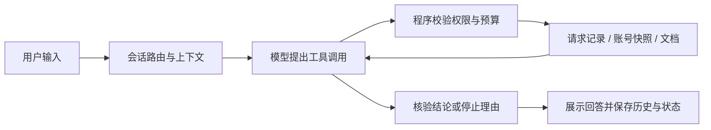

# SupportLab

面向开发者的 API 故障诊断 Agent：根据请求编号查询实际记录、账号快照和版本化文档，输出带依据的诊断；资料不足时追问或给出转人工说明。

本项目使用**虚构服务、构造业务数据和本地 SQLite**。可完全离线演示，也可接入 DeepSeek 运行真实模型工具调用。它是可复现的个人工程项目，尚未部署为线上客服产品。

## 一条完整例子

输入 `req_demo_018`，系统查询该请求的错误码、对应时刻的账号状态和规则文档。模拟快照显示当时月度额度为 `1000/1000`，程序核对证据后给出额度用尽的历史诊断。

如果缺少对应快照，系统不能只凭 `429` 猜测根因；它应说明资料缺口。历史快照也不代表当前月份的剩余额度。



外层路由、权限、预算、状态保存由程序控制；动态诊断中，模型根据工具反馈选择下一步。

## 已实现的功能

| 模块 | 实现与边界 |
| --- | --- |
| 工具调用 | `get_request_record`、`get_account_state`、`search_docs`；白名单、参数校验、可信账号范围、超时及调用预算 |
| 诊断与停止 | 六种登记原因：频率超限、月度额度用尽、凭据撤销、凭据过期、缺少权限、关联上游事件；超时执行结果未知时交接 |
| 文档 RAG | 4 篇资料、32 个索引片段；关键词/FTS、有限别名、来源引用、无证据拒答；未使用向量检索 |
| 会话与上下文 | SQLite 保存多轮历史和明确设置的展示偏好；有预算的历史参考包；历史答案不能替代本次工具证据 |
| 任务续接 | LangGraph 与 SQLite 检查点支持缺编号暂停、补编号继续及取消任务；不支持模型中途崩溃后的任意位置重放 |
| 失败恢复 | 最终格式错误最多纠正一次，占原调用预算；纠正后仍需证据检查；不自动重试未知执行结果 |
| 运行记录 | 工具结果、错误、调用次数、延迟和可获得的 token 用量；mock 与真实调用明确区分 |
| 对照评估 | 文档 RAG、固定工具流程 + LLM、动态 Agent；另有用于离线复现的固定规则模式 |

文档问答使用独立索引路径，诊断工具 `search_docs` 保留较早的关键词检索路径。文档问答的真实模式由模型选择引用，再由程序展示原文，不能等同于任意长文生成或总结。

## 快速运行：无需 API

已验证环境：Windows、Python 3.12.3。以下命令在项目目录运行：

```powershell
py -3.12 -m venv .venv
.\.venv\Scripts\python.exe -m pip install -r requirements.lock.txt
.\.venv\Scripts\python.exe -m supportlab app-demo
```

`app-demo` 使用临时模拟数据，检查偏好、暂停续接、文档问答和历史等功能，不调用模型 API。Linux/macOS 可使用 `python3.12 -m venv .venv` 和 `.venv/bin/python`；该平台尚未实机验证。

要体验持久化交互，先准备模拟数据与索引，再使用一个新的会话名：

```powershell
.\.venv\Scripts\python.exe -m supportlab init-demo --extended
.\.venv\Scripts\python.exe -m supportlab kb-build
.\.venv\Scripts\python.exe -m supportlab chat --session offline-demo
```

依次输入：

```text
以后回答简洁一些
帮我排查
req_demo_018
/docs 429 是什么意思
/history
/context
/exit
```

`init-demo` 用于准备或重置演示业务数据。使用同一会话名可继续历史任务；新会话不带真实模式标记时使用零 API 的固定流程。

## 可选：接入真实模型

复制 `.env.example` 为 `.env.local`，在本机填入自己的 DeepSeek API 配置。真实密钥文件、运行数据库和虚拟环境已被 Git 忽略。

```powershell
# 动态 Agent：模型选择工具，会产生 API 调用
.\.venv\Scripts\python.exe -m supportlab chat --session live-demo --live

# 固定工具流程 + 同一模型，会产生 API 调用
.\.venv\Scripts\python.exe -m supportlab chat --session workflow-demo --workflow
```

模型名称通过 `DEEPSEEK_MODEL` 配置，安装依赖使用锁定文件。会话会保存运行模式：继续已有真实会话时，即使省略 `--live` 仍会调用模型，切换模式应使用新会话名。

每条诊断最多 4 次模型请求、4 次工具尝试；文档问答最多 2 次模型请求，格式纠正包含在上限内。整个多轮会话没有整体费用上限，使用 `/exit` 结束；`/usage` 只统计已保存轮次，不代表供应商账单。

## 验证与实验记录

```powershell
# 程序测试与离线演示，不消耗模型 API
.\.venv\Scripts\python.exe -m unittest discover -s tests -q
.\.venv\Scripts\python.exe -m supportlab recovery-demo
.\.venv\Scripts\python.exe -m supportlab compare --case rate-ok

# 检查已封存代码、数据集及首次报告的完整性
.\.venv\Scripts\python.exe -m supportlab.acceptance_release --verify-only
```

以下为仓库保留的不同阶段记录，不能合并为一个“模型准确率”：

| 验证 | 保存结果 | 能说明什么 |
| --- | --- | --- |
| 完整程序测试 | 253/253（2026-10-13，发布预览副本） | 不含密钥和本地数据库的副本通过程序检查，不是真实模型评测 |
| 离线连续对话演示 | [13/13](reports/memory-context-lesson-2026-10-12.json) | 构造数据上的会话功能检查 |
| 原 40 条封存场景 | [首次 25/40](reports/holdout-v1-first-2026-10-06.json)，[修复后 40/40](reports/holdout-v1-regression-2026-10-06.json) | 修复后重跑属于回归，不能代替首次结果 |
| 新补充的 12 条场景 | [首次 12/12](reports/holdout-v2-first-2026-10-06.json) | 冻结后新组合场景的离线应用验收，人工复核待完成 |
| 本地重复检查 | [16/16，API=0](reports/stability-offline-2026-10-06.json) | 验证重复运行程序；不能证明真实模型稳定性 |
| 单案例真实对照 | [两组均正确](reports/comparison-live-rate-2026-10-06.json) | 该次固定流程 1 次 API / 3 次工具，Agent 4 次 API / 4 次工具；不能推断架构普遍优劣 |

已保留真实模型的成功、格式失败及恢复记录。数据与预期主要由 AI 辅助构造，独立人工复核、广泛真实模型评估和重复稳定性验证尚未完成。对照保持相同模型、工具权限、案例资料和预算上限，但提示词、证据传入形式及实际查询不同，限制详见报告。

## 代码与资料入口

| 路径 | 职责 |
| --- | --- |
| `supportlab/agent.py`、`execution.py` | 调用循环与受控工具执行 |
| `supportlab/knowledge.py`、`rag.py` | 文档索引、检索与引用输出 |
| `supportlab/conversation.py`、`memory.py` | 会话路由、任务状态、历史、偏好与上下文 |
| `supportlab/answer_check.py`、`diagnostic_check.py`、`stop_check.py` | 核验登记范围内的诊断与停止依据 |
| `evals/`、`tests/`、`reports/` | 场景、程序测试、封存清单、实验与失败记录 |
| `data/*.json`、`docs/demo-*.md` | 构造业务数据与固定版本规则 |

- [功能使用指南](docs/agent-v1-guide.md)
- [故障类型与证据边界](docs/diagnostics-2026-10-06.md)
- [固定流程与动态 Agent 对照](docs/optimization-2026-10-06.md)
- [首次失败、修复与补充验收](docs/acceptance-2026-10-06.md)
- [重复验证方案及限制](docs/stability-2026-10-06.md)

## 当前范围

当前交付为本地命令行原型，没有网页产品、生产身份平台、自动工单写入或多 Agent 协作。转人工只生成说明，不联系真实客服。证据核验针对登记的事实与规则，不能保证任意生成内容均正确；不将模拟业务、离线验证或少量真实调用描述为线上业务效果。
